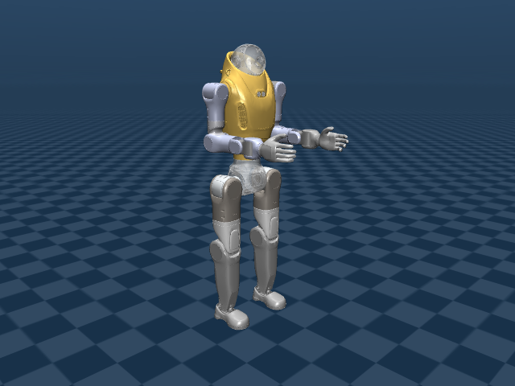

# Menagerie Lite

[](README.md) [](README.zh-CN.md)

[](https://github.com/Dynamicx-Loop/menagerie-lite/actions/workflows/build.yml)

**Menagerie Lite** is a collection of robot and sensor models for the
[MuJoCo](https://github.com/google-deepmind/mujoco) physics engine. Its organization
follows [MuJoCo Menagerie](https://github.com/google-deepmind/mujoco_menagerie),
with five active native MJCF models across three families, grouped into
Humanoids and Miscellaneous. Astro P1, SOMA-23, and Atom P3 are archived and retained
separately as legacy references. “Lite” refers to the deliberately small, curated
catalogue.

Each model directory contains the robot description, a scene, local assets,
derivation notes, and licensing records. Source fidelity and available controls
vary by model; the individual READMEs describe those limits.

- [Getting Started](#getting-started)
- [Model Quality and Contributing](#model-quality-and-contributing)
- [Menagerie Models](#menagerie-models)
- [Legacy Models](#legacy-models)
- [Acknowledgments](#acknowledgments)
- [Changelog](#changelog)
- [License and Disclaimer](#license-and-disclaimer)

Existing users: install the `menagerie-lite` distribution and update Python
imports and the CLI command from `menagerie_x` to `menagerie_lite`. See
[ADR 0015](docs/adr/0015-menagerie-lite-project-identity.md).

## Getting Started

### Prerequisites

The repository pins native MuJoCo **3.11.0** and requires Python 3.12 or later.
The robot READMEs state the tested version; an older minimum version has not
been established for these local models. Install the checkout's dependencies
with [uv](https://docs.astral.sh/uv/):

```bash
git clone https://github.com/Dynamicx-Loop/menagerie-lite.git
cd menagerie-lite
uv sync --locked --extra dev
```

### Overview

All robot families follow the same native organization. For example:

```text
lumo/
├── assets/                  # shared Astro and Unitree hand meshes
├── lumo.xml                 # 29 position-servo gallery default
├── lumo_mjlab.xml           # shared unactuated physical model
├── lumo.png                 # scene preview
├── scene.xml                # default scene
├── lumo_with_hands.xml  # same body plus 14 Dex3-1 finger DoFs
├── scene_with_hands.xml     # dexterous-hand scene
├── README.md
├── CHANGELOG.md
├── LICENSE                 # Apache-2.0 for Astro material
├── LICENSING.md
├── LICENSE.Unitree
└── provenance/             # original source/conversion records
```

Edit the family-root model and scene XML directly. Retained imports and
`provenance/` records are source evidence; no regeneration step is required. Scenes keep each robot's
coordinate datum, with lowered floors for several zero-height models.

A family can be copied and loaded independently of the Python catalog or
application manifest. Keep its `assets/` directory. Other retained descriptions
may also use a family-local `meshes -> assets` link.

### Usage

Open a native scene in MuJoCo's interactive viewer:

```bash
uv run python -m mujoco.viewer --mjcf lumo/scene.xml
```

Or load it through the native Python bindings:

```python
import mujoco

model = mujoco.MjModel.from_xml_path("lumo/scene.xml")
data = mujoco.MjData(model)
mujoco.mj_step(model, data)
```

Scenes use native reference initialization. Select named keyframes explicitly;
for example, the Lumo with hands model's `fist` keyframe is not selected by a
normal reset. Standard G1 provides the `stand` keyframe.

Workbench, URDF compatibility, and MJX remain deferred. Legacy application code
and metadata are retained, but may select old snapshots rather than native root
XML. Use top-level family paths: the stale `robots/` directory is retired.
See [UPSTREAM.md](UPSTREAM.md) for ownership and migration details.

## Model Quality and Contributing

`make all` checks native layout and XML style, loads and steps every declared
active and legacy model/scene, checks the shared Astro body and hand sources,
checks the standard G1 source hashes and position-servo contract, checks existing
keyframe reset, and loads standalone copied
family folders. CI runs the same native checks. See
[CONTRIBUTING.md](CONTRIBUTING.md) for editing and validation conventions.

These checks cover loading and short simulation; they do not certify a stable
controller, hardware dynamics, or every possible contact configuration. Some
models have no actuators. The Astro Dex3-1 hand mount is an unverified sample.

### Quick contributor setup

```bash
make install
make all
```

## Menagerie Models

The gallery shows one representative for each of three families; the catalog
contains five active models, including variants described in the family READMEs.
DoF counts exclude the floating base. Click a preview to open its
scene in [MuJoCo Live](https://live.mujoco.org/), or a model name for its description.
Viewer links load the latest published `main` branch.
The online viewer may start simulating immediately. Use **Pause**, then **Reset**
for pose inspection; a free humanoid may fall without a balancing controller.

### Humanoids

Humanoid previews are native renders with collision overlays hidden and no
simulation stepping. The standard G1 preview uses its `stand` keyframe; other
humanoid previews use reference initialization. Collision alternatives can
share the same visual appearance.

| Preview | Name | DoFs | License |
| :---: | --- | --- | --- |
| <a href="https://live.mujoco.org/?model=github:Dynamicx-Loop/menagerie-lite/main/lumo/scene.xml"></a> | [Lumo](lumo/README.md) | 29 | [Apache-2.0 body; BSD-3-Clause servos](lumo/LICENSING.md) |
| <a href="https://live.mujoco.org/?model=github:Dynamicx-Loop/menagerie-lite/main/unitree_g1/scene.xml"></a> | [Unitree G1](unitree_g1/README.md) | 29 | [BSD-3-Clause](unitree_g1/LICENSE.Menagerie) |

Lumo's 29-DoF gallery model uses position servos with joint-angle controls in
radians. See the [Lumo description](lumo/README.md) for its hand-equipped
variant, collision geometry, and retained sources.

The standard G1 model is imported from MuJoCo Menagerie and uses position
targets in radians. See the [G1 description](unitree_g1/README.md) for its
box-feet variant and control and collision details.

### Miscellaneous

| Preview | Name | DoFs | License |
| :---: | --- | --- | --- |
| <a href="https://live.mujoco.org/?model=github:Dynamicx-Loop/menagerie-lite/main/realsense_d435i/scene.xml"></a> | [RealSense D435i](realsense_d435i/README.md) | 0 | [Apache-2.0](realsense_d435i/LICENSE) |

The D435i model and preview image are imported from MuJoCo Menagerie. It is a
fixed geometry and collision model and does not define camera image streams
or IMU sensors.

## Legacy Models

[Atom P3](atom_p3/README.md) is **archived**. Its descriptions, preview, assets
and source records remain available for reference, with baseline native loading
checks. Ten encoded retained mesh files have unresolved cross-device behavior,
and one decoded mesh is truncated. Repair and all-mesh validation are deferred;
see the [archive record](docs/design/archive-atom-p3.md). Atom P3 is excluded
from the active gallery and model map.

[Astro P1](astro_p1/README.md) is **archived**. Its [30-DoF](astro_p1/scene.xml) and [27-DoF](astro_p1/scene_27dof.xml) models remain available for reference and native loading checks.

[SOMA-23](soma23/README.md) is **archived**. Its model and source records remain available for reference and native loading checks. Both families are excluded from the active gallery and model map.

## Acknowledgments

This collection retains models and source material from Unitree Robotics,
NVIDIA ProtoMotions, and the existing Astro and Atom bundles. Family source
records identify the available revisions, hashes, modifications, and notices.

MuJoCo Menagerie provides the reference layout, XML formatter, and native
validation conventions. [UPSTREAM.md](UPSTREAM.md) records the pinned upstream
revision and the scope of copied or adapted material. Menagerie Lite is maintained
separately from Google DeepMind's collection.

## Changelog

Repository updates are recorded in [CHANGELOG.md](CHANGELOG.md). Each model
family also has a changelog linked from its README.

## License and Disclaimer

Models and assets retain their individual terms. The gallery links the relevant
license or provenance status for each model; the complete scope is recorded in
[LICENSING.md](LICENSING.md) and each family's licensing notes. The Lumo body
and unactuated base use Apache-2.0; adapted default servos and Unitree hand material retain BSD-3-Clause
terms. Legacy Astro P1 and Atom bundles retain their recorded
unresolved status.

Copied or adapted upstream tooling retains its Apache-2.0 notices and
[license text](LICENSES/Apache-2.0.txt); presentation scenes retain their
[upstream G1 notice](LICENSES/MuJoCo-Menagerie-G1.txt). Model-specific licenses
do not extend to unrelated materials in the repository.
