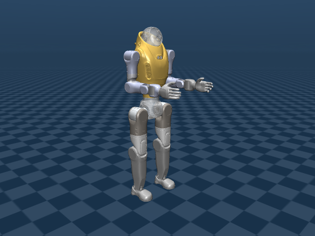
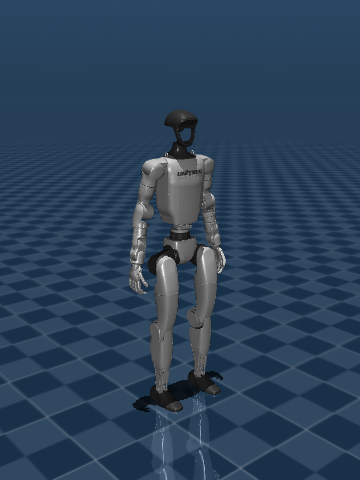
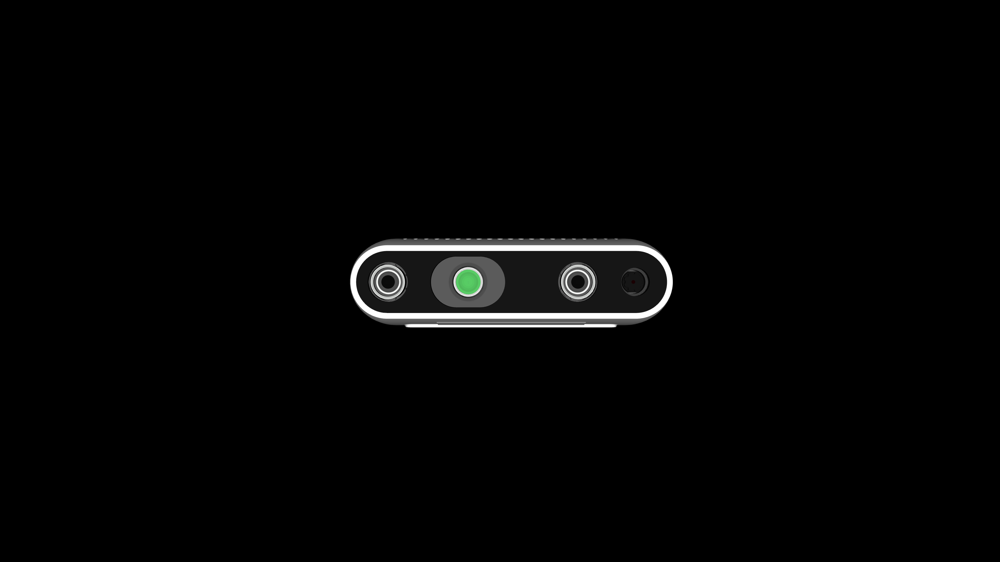

# Menagerie Lite

[](README.md) [](README.zh-CN.md)

[](https://github.com/Dynamicx-Loop/menagerie_lite/actions/workflows/build.yml)

**Menagerie Lite** 是一个面向 [MuJoCo](https://github.com/google-deepmind/mujoco) 物理引擎的机器人和传感器模型集合。其组织方式遵循 [MuJoCo Menagerie](https://github.com/google-deepmind/mujoco_menagerie)，包含三个系列中的五个活跃原生 MJCF 模型，分为人形机器人和其他模型。Astro P1、SOMA-23 和 Atom P3 已归档，作为历史参考单独保留。“Lite” 表示这是一个刻意保持精简、经过筛选的模型集合。

每个模型目录都包含机器人描述、场景、本地资源、派生说明和许可记录。各模型的源文件保真度和可用控制方式有所不同；各自的 README 描述了这些限制。

- [快速开始](#快速开始)
- [模型质量与贡献](#模型质量与贡献)
- [Menagerie 模型](#menagerie-模型)
- [历史模型](#历史模型)
- [致谢](#致谢)
- [变更日志](#变更日志)
- [许可与免责声明](#许可与免责声明)

现有用户请安装 `menagerie_lite` 包，并将 Python 导入和命令行命令从
`menagerie_x` 更新为 `menagerie_lite`。详见 [ADR 0015](docs/adr/0015-menagerie-lite-project-identity.md)。

## 快速开始

### 前提条件

本仓库锁定原生 MuJoCo **3.11.0**，并要求 Python 3.12 或更高版本。机器人 README 说明了经过测试的版本；这些本地模型尚未确定更早的最低支持版本。使用 [uv](https://docs.astral.sh/uv/) 安装检出版本的依赖：

```bash
git clone https://github.com/Dynamicx-Loop/menagerie_lite.git
cd menagerie_lite
uv sync --locked --extra dev
```

### 概览

所有机器人系列遵循相同的原生组织方式。例如：

```text
lumo/
├── assets/                  # 共享的 Astro 和 Unitree 手部网格
├── lumo.xml                 # 29 自由度位置伺服展示默认模型
├── lumo_mjlab.xml           # 共享的无驱动物理模型
├── lumo.png                 # 场景预览
├── scene.xml                # 默认场景
├── lumo_with_hands.xml  # 相同的本体加上 14 个 Dex3-1 手指自由度
├── scene_with_hands.xml     # 灵巧手场景
├── README.md
├── CHANGELOG.md
├── LICENSE                 # Astro 材料的 Apache-2.0 许可
├── LICENSING.md
├── LICENSE.Unitree
└── provenance/             # 原始来源和转换记录
```

直接编辑系列根目录下的模型和场景 XML。保留的导入文件和 `provenance/` 记录是来源证据；无需重新生成。场景保留各机器人的坐标基准，对若干零高度模型降低了地面。

每个系列都可以独立于 Python 模型索引或应用清单复制和加载。请保留其 `assets/` 目录。其他保留的描述文件也可能使用系列内的 `meshes -> assets` 链接。

### 使用方法

在 MuJoCo 的交互式查看器中打开原生场景：

```bash
uv run python -m mujoco.viewer --mjcf lumo/scene.xml
```

或者通过原生 Python 绑定加载：

```python
import mujoco

model = mujoco.MjModel.from_xml_path("lumo/scene.xml")
data = mujoco.MjData(model)
mujoco.mj_step(model, data)
```

场景使用原生参考初始化。请显式选择命名关键帧；例如，普通重置不会选择带手 Lumo 模型的 `fist` 关键帧。标准 G1 提供 `stand` 关键帧。

Workbench、URDF 兼容性和 MJX 仍暂缓实现。保留的旧版应用代码和元数据可能选择旧快照而非根目录下的原生 XML。请使用顶层系列路径：过时的 `robots/` 目录已停用。所有权和迁移详情见 [UPSTREAM.md](UPSTREAM.md)。

## 模型质量与贡献

`make all` 检查原生布局和 XML 样式，加载并步进每个声明的活跃及历史模型和场景，检查共享的 Astro 本体及手部来源，检查标准 G1 来源哈希和位置伺服约定，检查现有关键帧重置，并加载单独复制的系列文件夹。CI 运行相同的原生检查。编辑和验证规范见 [CONTRIBUTING.md](CONTRIBUTING.md)。

这些检查涵盖加载和短时仿真；它们不能证明控制器稳定、硬件动力学准确或所有接触配置均有效。某些模型没有驱动器。Astro Dex3-1 手部安装是未经验证的示例。

### 贡献者快速设置

```bash
make install
make all
```

## Menagerie 模型

展示区为三个系列各显示一个代表；模型索引包含五个活跃模型，其中包括系列 README 中描述的变体。自由度数量不包括浮动基座。点击预览可在 [MuJoCo Live](https://live.mujoco.org/) 中打开场景，点击模型名称可查看其描述。查看器链接加载最新发布的 `main` 分支。

在线查看器可能立即开始仿真。查看姿态时请先使用 **Pause**，再使用 **Reset**；没有平衡控制器的自由人形机器人可能会摔倒。

### 人形机器人

人形机器人预览是隐藏碰撞叠加层且未进行仿真步进的原生渲染。标准 G1 预览使用其 `stand` 关键帧；其他人形机器人预览使用参考初始化。不同碰撞配置可能具有相同的视觉外观。

| 预览 | 名称 | 自由度 | 许可 |
| :---: | --- | --- | --- |
| <a href="https://live.mujoco.org/?model=github:Dynamicx-Loop/menagerie_lite/main/lumo/scene.xml"></a> | [Lumo](lumo/README.md) | 29 | [Apache-2.0 本体；BSD-3-Clause 伺服](lumo/LICENSING.md) |
| <a href="https://live.mujoco.org/?model=github:Dynamicx-Loop/menagerie_lite/main/unitree_g1/scene.xml"></a> | [Unitree G1](unitree_g1/README.md) | 29 | [BSD-3-Clause](unitree_g1/LICENSE.Menagerie) |

Lumo 的 29 自由度展示模型使用位置伺服，关节角控制量以弧度为单位。其带手变体、碰撞几何和保留来源见 [Lumo 描述](lumo/README.md)。

标准 G1 从 MuJoCo Menagerie 导入，使用以弧度为单位的位置目标。其箱形足变体以及控制和碰撞详情见 [G1 描述](unitree_g1/README.md)。

### 其他模型

| 预览 | 名称 | 自由度 | 许可 |
| :---: | --- | --- | --- |
| <a href="https://live.mujoco.org/?model=github:Dynamicx-Loop/menagerie_lite/main/realsense_d435i/scene.xml"></a> | [RealSense D435i](realsense_d435i/README.md) | 0 | [Apache-2.0](realsense_d435i/LICENSE) |

D435i 模型和预览图从 MuJoCo Menagerie 导入。它是固定的几何和碰撞模型，不定义相机图像流或 IMU 传感器。

## 历史模型

[Atom P3](atom_p3/README.md) 已**归档**。其描述、预览、资源和来源记录仍可供参考，并保留基础原生加载检查。十个编码后的保留网格文件在跨设备使用时的行为尚未解决，另有一个解码后的网格被截断。修复和全网格验证暂缓；见[归档记录](docs/design/archive-atom-p3.md)。Atom P3 不包含在活跃展示区和模型映射中。

[Astro P1](astro_p1/README.md) 已**归档**。其 [30 自由度](astro_p1/scene.xml)和 [27 自由度](astro_p1/scene_27dof.xml)模型仍可供参考，并保留原生加载检查。

[SOMA-23](soma23/README.md) 已**归档**。其模型和来源记录仍可供参考，并保留原生加载检查。这两个系列均不包含在活跃展示区和模型映射中。

## 致谢

本集合保留了来自 Unitree Robotics、NVIDIA ProtoMotions 以及现有 Astro 和 Atom 包的模型与来源材料。各系列的来源记录标明了可用的修订、哈希、修改和声明。

MuJoCo Menagerie 提供了参考布局、XML 格式化工具和原生验证规范。[UPSTREAM.md](UPSTREAM.md) 记录了锁定的上游修订以及复制或改编材料的范围。Menagerie Lite 独立于 Google DeepMind 的集合进行维护。

## 变更日志

仓库更新记录在 [CHANGELOG.md](CHANGELOG.md) 中。每个模型系列也有从其 README 链接的变更日志。

## 许可与免责声明

模型和资源保留各自的许可条款。展示区链接到各模型的相关许可或来源状态；完整范围记录在 [LICENSING.md](LICENSING.md) 和各系列的许可说明中。Lumo 本体及无驱动基础模型使用 Apache-2.0；改编的默认伺服和 Unitree 手部材料保留 BSD-3-Clause 条款。历史 Astro P1 和 Atom 包保留其记录中的未解决状态。

复制或改编的上游工具保留其 Apache-2.0 声明和[许可文本](LICENSES/Apache-2.0.txt)；展示场景保留其[上游 G1 声明](LICENSES/MuJoCo-Menagerie-G1.txt)。模型专属许可不适用于仓库中的无关材料。
