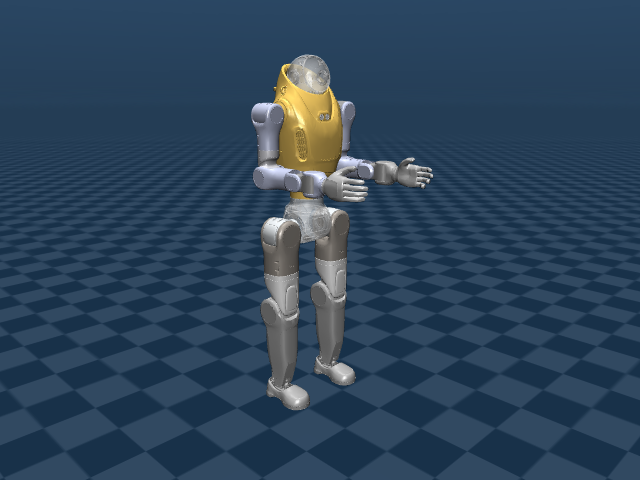
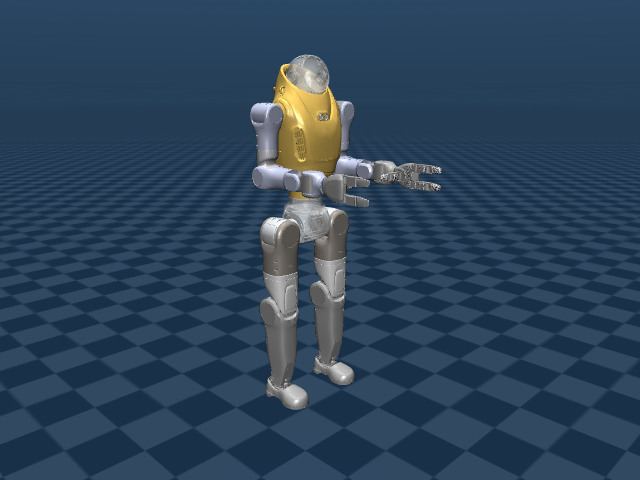
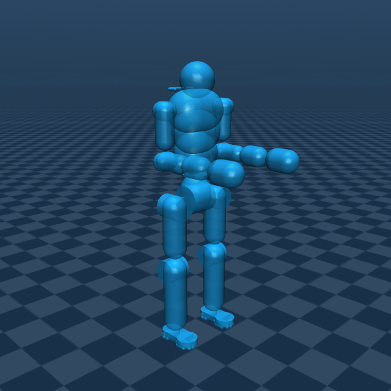

# Lumo Description (MJCF)

> [!IMPORTANT]
> Tested with MuJoCo 3.11.0, the version pinned by this repository.

## Changelog

Model history: [CHANGELOG.md](CHANGELOG.md).

## Overview

Lumo was previously cataloged as Astro P2. Migrate `astro_p2/astro_p2.xml` to
`lumo/lumo_mjlab.xml` for the original unactuated behavior, and
`astro_p2/astro_p2_with_hands.xml` to `lumo/lumo_with_hands.xml`. The new
`lumo/lumo.xml` is the position-actuated gallery default; the scene filenames
remain the same under `lumo/`.
The application variant ID changes from `astro_p2` to `lumo`. No compatibility
alias is provided. Historical source records retain their original names and
paths. See [the identity decision](../docs/adr/0013-lumo-identity-and-archives.md).

Lumo has one fixed-head 29-DoF body with two maintained hand configurations.
The default uses Astro's fixed hands and 29 joint position servos. The shared
unactuated physical model is retained as `lumo_mjlab.xml`. **Lumo with hands** adds 14 Unitree
Dex3-1 finger joints for 43 total DoFs; its hand meshes use silver coloring.

  
  

| Model | Body DoFs | Hand DoFs | Actuators | Scene |
| --- | --- | --- | --- | --- |
| [lumo.xml](lumo.xml) — Lumo | 29 | 0 | 29 position servos | [scene.xml](scene.xml) |
| [lumo_mjlab.xml](lumo_mjlab.xml) — unactuated base | 29 | 0 | None | Load the XML directly |
| [lumo_with_hands.xml](lumo_with_hands.xml) — Lumo with hands | 29 | 14 | None | [scene_with_hands.xml](scene_with_hands.xml) |

DoF counts exclude the floating base. Previews use native reference
initialization without simulation stepping.

## MJCF derivation steps

1. Retained the refined Astro/Dex3-1 MJCF body, including masses, inertias,
   joints and source coordinate frames; fixed the head for a 29-DoF body.
2. Consolidated models and shared meshes into this self-contained family.
   Each scene assembles its sibling robot XML and a floor at `z=-0.75`.
3. Restored original Astro hand meshes, fixed-joint transforms and inertias
   for the default model. The earlier G1 hand trial was superseded.
4. Preserved the articulated model's 14 finger joints, physics and `fist`
   keyframe. Its public label is Lumo with hands.
5. Tuned the default palms, wrist capsules, shin capsules and upper pelvis
   cylinder. Merged axial upper-arm capsules and attached them to shoulder-roll
   for automatic forearm contacts. The maintainer's final upper-arm centerlines
   are `0 0 0 0 0 -0.12`, with radii 0.037 m left / 0.039 m right.
6. Retired the separate simplified collision variant after the default design
   was approved. Its XML, scene, previews and derivation record are frozen under
   [provenance/retired_simplified/](provenance/retired_simplified/README.md).
   They are historical evidence, outside the active catalog and native checks.
7. Synchronized the articulated-hand model's 50 non-hand colliders and its two
   forearm/wrist overlap exclusions with the approved default. Preserved the
   articulated hand geometry, joints, inertias, visuals and `fist` keyframe.

## Collision geometry

The approved default has **52 collision geoms** and **37 visual mesh geoms**.
Group 1 contains visual meshes with collision disabled; group 3 contains
collision primitives with automatic contact masks enabled. Viewer visibility
changes do not disable contact.

The default assembles both feet from one shared [foot_collisions.xml](foot_collisions.xml)
model. `lumo_mjlab.xml` declares it as a model asset and attaches its `foot_link`
body inside each ankle-roll body with `left_` / `right_` name prefixes. The shared
definition has 11 collision geoms: eight sole capsules, two side cylinders and one
bridge box. Edit this file to tune both feet together, separately from the body
colliders. The existing symmetric collision envelope, body frames and contact
settings are preserved; right-foot sole-row numbering now follows the left foot.
The actuated `lumo.xml` attaches this shared base as a native model asset. Keep `lumo_mjlab.xml` and
`foot_collisions.xml` alongside it when copying the model.
The default scene also uses a model asset and attachment for the whole robot,
so its nested collision assets resolve correctly when loading a relative scene path
with the pinned MuJoCo version.

The neck-handle crossbar and its two supports live in
[neck_handle_collisions.xml](neck_handle_collisions.xml). The default attaches
this model's geoms directly to `waist_roll_link`, preserving their original
names, local coordinates and body ownership. Edit this file to tune the handle
independently, and keep it alongside both Lumo XML files when copying the model.

Each continuous upper-arm capsule belongs to the shoulder-roll body. A real
shoulder-yaw body separates it from the forearm-owning elbow body, allowing
normal automatic contact. There are **no explicit contact pairs or elbow-stop
proxy spheres**. The existing left/right elbow-to-wrist-pitch body exclusions
avoid permanent overlap of those neighboring envelopes. All other contact
filtering remains native; automatic contacts use frictional `condim=3` settings.

The palm capsules have radius 0.05 m and wrist-yaw-frame centerlines x=0.10–0.15 m.
Extended fingers/thumb intentionally lie outside this approximation. Each shin
centerline is `0.015 0 -0.24 0.015 0 0.003`; the proximal extension starts knee
contact near −3.88°, before the −5.16° native limit. The upper pelvis cylinder
has radius 0.057 m, half-length 0.018 m and center z=0.10 m.

  

Contacts and angle limits are compliant. Existing thigh–shin contact near
133.3° still precedes the configured 139.8° knee maximum. No hardware contact
calibration, performance improvement or powered-controller stability is claimed.

The articulated-hand model has **68 collision geoms**: the same 50 non-hand
colliders as the default, plus its unchanged 18 Dex3-1 hand colliders. Its upper
arms, forearms, wrists, pelvis and shins use the approved default geometry and
automatic contact policy, including the two forearm/wrist-pitch overlap
exclusions. Feet retain the same physical envelope despite historical right-foot
row names and reversed capsule endpoints. Its inline foot/neck definitions
remain separate from the default's shared collision assets. See the
[articulated collider verification](../docs/astro-articulated-collider-verification.md)
for the complete comparison and preservation checks. Visual mesh previews
remain applicable because visual geometry is unchanged.

## Model notes

The default has `nq=36`, `nv=35`, `nu=29` and mass **40.58255359 kg**. It
attaches `lumo_mjlab.xml` and adds position servos following standard Menagerie
G1: `kp=500`, `dampratio=1`, and control ranges inherited from the joints.
`data.ctrl` contains 29 joint-angle targets in radians in native joint order.
Each actuator retains its Lumo joint's torque cap (10–130 Nm by joint); G1's
torque limits, armature and friction are not copied. The default model and
scene use implicitfast integration at a 0.002 s timestep.

The unactuated base preserves the previous XML byte-for-byte (`nu=0`, Euler).
Its MJLab-style name identifies the geometry/actuation split; MJLab runtime
integration is not verified. The articulated model remains unchanged with
`nq=50`, `nv=49`, `nu=0` and mass **41.69666115 kg**, using Euler at 0.002 s.
G1-style gains are an initial simulation setup rather than Lumo-specific tuning.
Position servos do not provide free-base balance; the gallery keeps the same
reference pose and visual preview. Select
`fist` explicitly for the articulated closure; ordinary reset uses the reference
configuration. Dex3-1 attachments are samples, not verified mechanical adapters.

Mesh hashes, hand inertias and current collision provenance are recorded in
[provenance/rubber_hands.json](provenance/rubber_hands.json). Original conversion
notes under [provenance/29dof/](provenance/29dof/MJCF.md) and
[provenance/dex3_1/](provenance/dex3_1/DERIVATION.md) are historical evidence;
their old build commands are not supported regeneration steps. Edit geometry in
`lumo_mjlab.xml`, servo definitions in `lumo.xml`, and the shared collision models
directly. Both default versions share the same physical description.
[Final verification](../docs/astro-p2-collision-retirement.md) records
approval preservation and retirement checks.

Workbench, URDF compatibility and MJX runtime remain deferred.

## License

The Lumo body and unactuated base are released under the
[Apache License, Version 2.0](LICENSE). The position-servo default also retains
[BSD-3-Clause terms](LICENSE.Menagerie) for its adapted Menagerie configuration.
The articulated alternative combines
Apache-2.0 Astro body material with Unitree hand material under
[BSD-3-Clause terms](LICENSE.Unitree). See [LICENSING.md](LICENSING.md).
