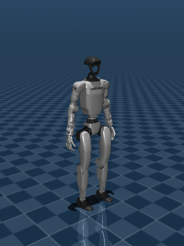

# Unitree G1 Description (MJCF)

Tested with the repository's pinned MuJoCo 3.11.0.
Model history: [CHANGELOG.md](CHANGELOG.md).

## Supported models

Exactly two configurations are maintained, both with 29 body joints and fixed
rubber hands. Joint counts exclude the floating base.

| Model | Source | Scene | Control input |
| --- | --- | --- | --- |
| [g1.xml](g1.xml), default | MuJoCo Menagerie, standard G1 | [scene.xml](scene.xml) | 29 position targets, radians |
| [unitree_g1_29dof_box_feet.xml](unitree_g1_29dof_box_feet.xml) | ProtoMotions | [scene_29dof_box_feet.xml](scene_29dof_box_feet.xml) | 29 motor torques, N m |

  
  

Both compile to `nq=36`, `nv=35`, `nu=29` and mass 33.341142 kg. Their control
arrays and collision configurations have different meanings; choose the model
that matches the controller. The standard model replaces the former
43-actuator torque-controlled hand model as the default.

## Standard MuJoCo Menagerie G1

The model and scene are byte-identical to upstream revision
`370c43965323c0944b433b202aac5058b5f907a9` (2026-11-10). Exact source URLs,
XML hashes and all 35 mesh hashes are in
[provenance/menagerie.json](provenance/menagerie.json).

- 35 visual mesh geoms and 36 collision geoms: 24 meshes, four shoulder
  cylinders and eight foot spheres. Collision selection uses automatic masks.
- 29 position servos with upstream `kp=500`, `dampratio=1` and joint-specific
  actuator force limits. Upstream notes that the gains need tuning.
- `implicitfast` integration with a 0.002 s timestep; joint armature 0.01 and
  friction loss 0.3. Four gyro/accelerometer sensors use pelvis and torso sites.
- The robot contains the `stand` keyframe. Select it explicitly with
  `mj_resetDataKeyframe`; loading XML alone uses the reference configuration.
  The preview selects `stand` and takes no simulation steps.
- `scene.xml` adds one floor and lighting. The robot alone contains no floor
  or lights. Neither file declares explicit contact pairs.

These are the standard upstream settings. Native load/step verification does
not establish controller stability or hardware readiness.

## ProtoMotions boxfeet

The existing model and scene are preserved unchanged. Source revision is
`a6df301d312dc58ac40a4d994f4f1064728d854c`, file
`protomotions/data/assets/mjcf/g1_bm_box_feet.xml`; metadata remains in the
[manifest](../manifest.json). The robot has 24 active collision geoms: 18
capsules, four spheres (including three tiny source marker spheres), and two
foot boxes. Each foot box has half-size `0.093 0.0365 0.02` m at local position
`0.039 0 -0.005` m. Position/velocity-dependent joint spring and damping terms
remain part of this model even though its actuators are torque motors.

The local import already repaired the source's missing `imu` site at torso
position `-0.03959 -0.00224 0.14792`, preserving both declared sensors. That
repair and the adapted mesh paths predate this cleanup. The retained
[MJCF import](mjcf/unitree_g1_29dof_box_feet.xml) remains evidence; maintain the
root model directly. The [retargeting URDF](urdf/for_retargeting/g1.urdf) is
source material, not a published matching URDF edition.

## Retired configurations and verification

The old articulated-hand and primitive MJX alternatives are absent from both
catalogs. Their XML, previews and original metadata are frozen under
[provenance/retired_variants](provenance/retired_variants/README.md). Shared
meshes and the official [hand URDF](urdf/unitree_g1_29dof_with_hand_rev_1_0.urdf)
remain source evidence. Archived relative XML paths are not runnable entry
points. Neither supported model claims a matching URDF.

[Review and verification](../docs/g1-variant-review.md) records the upstream
comparison, preservation checks and test results. Workbench/URDF parity and
MJX execution remain deferred. No controller training or hardware tests were run.

## License

Standard Menagerie XML and its assets retain the upstream BSD-3-Clause
[notice](LICENSE.Menagerie). Unitree descriptions and meshes retain
[BSD-3-Clause](LICENSE.Unitree). ProtoMotions descriptions retain
[Apache-2.0](LICENSE.ProtoMotions) and its [notice](NOTICE.ProtoMotions).
[LICENSING.md](LICENSING.md) describes the scope of each notice.
